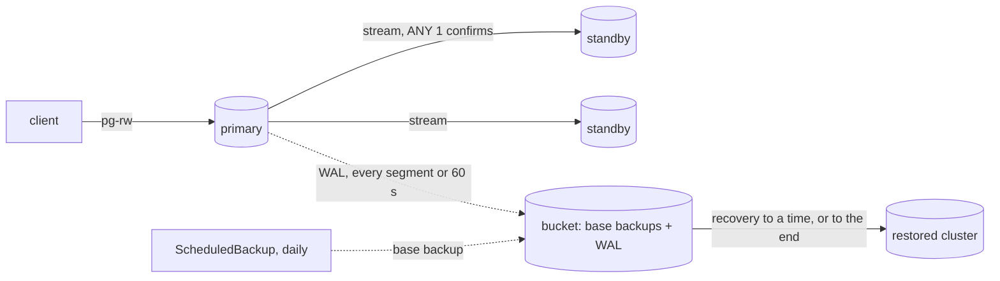

# kubernetes-postgres-recovery

[](https://github.com/heyvaldemar/kubernetes-postgres-recovery/actions/workflows/e2e.yml)
[](https://github.com/heyvaldemar/kubernetes-postgres-recovery/actions/workflows/verify.yml)
[](https://scorecard.dev/viewer/?uri=github.com/heyvaldemar/kubernetes-postgres-recovery)
[](https://www.bestpractices.dev/projects/15496)
[](https://github.com/heyvaldemar/kubernetes-postgres-recovery/blob/status/status.json)
[](https://github.com/heyvaldemar/kubernetes-postgres-recovery/blob/status/status.json)
[](https://github.com/heyvaldemar/kubernetes-postgres-recovery/blob/status/status.json)
[](https://github.com/heyvaldemar/kubernetes-postgres-recovery/blob/status/status.json)
[](https://github.com/heyvaldemar/kubernetes-postgres-recovery/blob/status/status.json)
[](https://github.com/heyvaldemar/kubernetes-postgres-recovery/blob/status/status.json)

The second row of badges is not typed by hand: it is the e2e workflow's last 30 days on main, rewritten after every run by [`.github/workflows/status.yml`](.github/workflows/status.yml) into the [`status`](https://github.com/heyvaldemar/kubernetes-postgres-recovery/tree/status) branch.

A backup nobody has restored is a hope with a storage bill. This repository runs PostgreSQL on Kubernetes with CloudNativePG and restores it every day, three ways: to a moment before a `DROP TABLE`, onto a standby after the primary is killed in the middle of writes, and from the bucket alone after the cluster and its volumes are deleted. Every restore is judged by reading the data back.


`make test` on a laptop, recorded with asciinema; waits are cut to two seconds and nothing else is edited. [`docs/demo/drill.cast`](docs/demo/drill.cast) replays it in a terminal (`asciinema play`).

It is a reference, not a product, and it does not run in production anywhere. It runs on kind at no cloud cost, with SeaweedFS standing in for S3.

## What is proven, and how

Every line is a check in [`tests/e2e/run.sh`](tests/e2e/run.sh) on a fresh cluster, or in [`scripts/validate.sh`](scripts/validate.sh).

| Claim | Proof |
|---|---|
| A malformed restore is refused before it starts | five restore manifests dry-run against the operator: a target that is not a time, two targets, an undeclared source are refused; a well-formed one is admitted, and so is a target time with no zone, which the operator reads as UTC (`tests/e2e/plants`) |
| A commit the client was told about survives the loss of the primary | a client inserts a row every 200 ms through the read-write service; the primary pod is force-deleted; every row the client saw committed is on the new primary |
| The database can be put back to a second before a mistake | 100 rows, a target time, row 101, then `DROP TABLE`. A new cluster restored from the bucket to the target has the 100 rows, not row 101, and the table |
| The bucket alone is enough | the cluster and its volumes are deleted; a cluster restored from the base backup and the archived WAL has the rows written before the loss |
| Archiving has a bound | with no forced WAL switch, `archive_timeout` ships the last write to the bucket within a minute |
| Backups are taken and land where they should | a base backup completes, continuous archiving reports success, and the bucket holds base backups and WAL for the cluster |
| Ready does not mean backed up, and the drill can tell | a cluster created again under the lost one's name serves queries and reports Ready, while the plugin refuses to archive over the old path (`Expected empty archive`); the run requires all three |
| Every static check can fail | 11 planted violations, each caught: an image by tag, a misspelled field, one instance, no synchronous standby, commits acknowledged with no standby, no archive bound, no WAL archiver, no retention window, a restore that writes into the backups it reads, a namespace without Pod Security restricted |

## What the drill measured

Three runs of the drill on a GitHub-hosted runner, commit [`6e58a4e`](https://github.com/heyvaldemar/kubernetes-postgres-recovery/commit/6e58a4e) ([1](https://github.com/heyvaldemar/kubernetes-postgres-recovery/actions/runs/38608534726), [2](https://github.com/heyvaldemar/kubernetes-postgres-recovery/actions/runs/38609694586), [3](https://github.com/heyvaldemar/kubernetes-postgres-recovery/actions/runs/38610785970)):

| | Measured |
|---|---|
| Acknowledged writes lost when the primary is killed | 0, in every run |
| From the kill to a new primary named by the operator | 5 to 22 s |
| Longest stretch without an acknowledged write, client with a 3 s connect timeout | 9 to 31 s |
| Restore to a point in time, until the restored cluster is ready | 52 s |
| Restore from the bucket alone, until ready | 50 to 54 s |

The spread in the failover is the operator's: the same kill gave a new primary after 5 seconds once and after 22 seconds twice. On a laptop it was 4 seconds.

The failover number depends on the client as much as on the database. Without a connect timeout, the first measurement here was 136 seconds: the client's connection to the killed primary's address waited out TCP's retries long after a standby had taken over. With `PGCONNECT_TIMEOUT=3` the pause follows the database: a few seconds past the promotion, while the read-write service moves to the new primary and the client's next attempt reaches it. An application with no connect timeout turns a failover of seconds into minutes.

The restore times are the floor of a restore, not a figure for a large database: a 1 GiB volume and a few hundred rows on a GitHub-hosted runner. A restore's time is copying the base backup and replaying WAL, and both grow with the data and with the time since the last base backup.

## Recovery objectives, in a customer's terms

| What is lost | Data lost (RPO) | Back in service (RTO) | What does it |
|---|---|---|---|
| The primary instance | none of what was acknowledged | the failover gap above | a synchronous standby (`ANY 1`) confirms each commit; the operator promotes it |
| A table, to a mistake | nothing before the chosen second, inside a 7-day window | the point-in-time restore above, while the damaged cluster keeps serving | base backups and archived WAL in the bucket |
| The whole cluster | at most the last minute of writes | the restore from the bucket above | `archive_timeout: 60s`, and a bucket outside the cluster |

The trade behind the first row is write latency: a commit waits for one standby's confirmation, and with `dataDurability: required` it waits rather than proceed when no standby can confirm. That is a choice a team makes knowingly; [ADR 2](docs/decisions/0002-synchronous-standby-required.md) explains it.

## How it works



- **The operator and the plugin** ([`scripts/install.sh`](scripts/install.sh), [`values/`](values/)): CloudNativePG 1.30.1 and its Barman Cloud plugin 0.15.1 from their charts, cert-manager 1.21.2 for the plugin's certificates. Every image by digest.
- **The database** ([`manifests/database/`](manifests/database/)): PostgreSQL 18.6, three instances, one synchronous standby required, WAL archived through the plugin's sidecar with a one-minute ceiling, a base backup daily and one at creation, a 7-day recovery window. Pod Security `restricted`.
- **The bucket** ([`manifests/object-store/`](manifests/object-store/)): SeaweedFS's S3 API, with keys generated at install and kept only in the cluster.
- **Restores** ([`manifests/recovery/`](manifests/recovery/)): a new cluster next to the old one, from the bucket, to a time or to the end. It reads the source's backups and cannot write into them.

## Quickstart

```bash
make up      # kind, cert-manager, CloudNativePG, the plugin, SeaweedFS, the database
make test    # the drill; destructive, it ends by deleting the cluster
make check   # the static checks, and each one shown its planted violation
make down
```

Needs Docker, make, python3 with PyYAML; `make` downloads kind, kubectl, helm and kubeconform at pinned versions, checked by sha256 ([`tools.lock`](tools.lock)).

## Runbooks

- [Point-in-time recovery](docs/runbooks/point-in-time-recovery.md): find the second before the mistake, restore next to the running cluster, check, then move the application.
- [Disaster recovery](docs/runbooks/disaster-recovery.md): the cluster is gone; restore from the bucket, check, make the restored cluster the new production one.

## Cost

Nothing in a cloud. On a provider, the bill is three instances and their volumes, plus object storage for seven days of WAL and the base backups in that window, which is mostly the WAL.

## What it does not do

The [threat model](docs/threat-model.md) lists every threat with its control and check, and what is not covered: the three instances share one kind node, so there is no zone to lose; the bucket lives in the same cluster and its keys can delete, where a real setup puts it in another account with object lock; there is no alert on a failed archive yet, only the daily drill; major version upgrades are not exercised.

## Repository

```
kind/                 the cluster: one node, its image by digest
values/               chart values: every image by digest
scripts/              install, validate, CRD schemas, pinned tools
manifests/            namespaces, the bucket, the database, restore templates
tests/e2e/run.sh      the drill
tests/static/         planted violations for every static check
docs/                 decisions, runbooks, threat model
```

## Decisions

[`docs/decisions/`](docs/decisions/): CloudNativePG with the Barman Cloud plugin over an operator-less setup; a synchronous standby with writes held rather than lost; a one-minute archive ceiling; restores that never archive into their source. Each ends with how the choice would be explained to a customer.

This repository is the database half of [aws-eks-reference-platform](https://github.com/heyvaldemar/aws-eks-reference-platform), whose backups are volume snapshots by Velero. A volume snapshot of a running PostgreSQL is crash-consistent at best and has no point in time between snapshots; WAL archiving has every second.

## Questions, bugs and changes

Open an [issue](https://github.com/heyvaldemar/kubernetes-postgres-recovery/issues) for a bug, a question or an idea. Security reports go privately, as [SECURITY.md](SECURITY.md) describes. Changes are welcome as pull requests: CI runs the same checks on them as on main, and a change ships with the check that proves it.

## How this is built

One maintainer and an AI agent. The agent writes most of the code; the decisions are mine, and so is the verification. Nothing merges on the agent's report that it works: it merges on the checks above, and each of them has been shown the failure it exists to catch. The drill's first local run failed on a permission, not on recovery: the test client wrote as the application's user into a table the superuser owned. The fix is in the drill, and the error message now reaches its output.

## License

[MIT](LICENSE)
